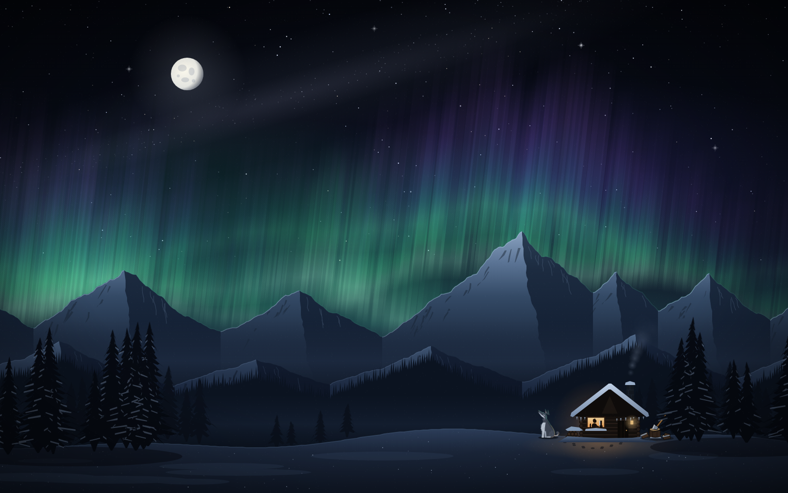

# Nordic night

A calm dark theme for the Claude desktop app: a northern night behind the conversation.



A green and violet aurora hangs over snowy mountains, with a moon, a pine forest and a small log cabin. Someone is working late at a desk behind the lit window, there is a chopping block with an axe by the door, and a husky sits in the snow watching the moon.

It is a quiet scene, and little of it moves:

- Smoke drifts from the chimney all the time.
- A gust passes through the trees every minute or minute and a half, and they all sway together for a few seconds.
- Every 40 to 50 seconds the husky bolts across the snow and comes back to sit. It holds still the rest of the time.
- Now and then the figure in the window leans in and nods.

A wind blows on a scale from -5 (hard to the left) to 5 (hard to the right). It wanders slowly with the time of day, one level at a time. It leans the aurora and gives it its length, bends the smoke, and sets how hard the trees sway.

Every animation follows the clock rather than starting from zero, so when the app draws the scene again it carries on where it was instead of restarting.

The interface gets a matching palette: slate-blue night surfaces, cool white text, and the aurora's hues for accents.

## Install

At the prompt of a Claude Code terminal session:

```
/plugin install nordic-night --marketplace JulioCesar97DB/nordic-night
```

Answer `y` to add the marketplace, then pick a scope. From a shell:

```
claude plugin install nordic-night --marketplace JulioCesar97DB/nordic-night
```

In the desktop app: click + next to the prompt box, then Plugins, Add marketplace with `JulioCesar97DB/nordic-night`, then Add plugin.

The scene is drawn by the Claude desktop and mobile apps. The terminal draws no theme.

## Changing the scene

The scene is generated. Edit `scene/build-scene.mjs` and run:

```
node scene/build-scene.mjs
```

It writes `hooks/scene.js`. Pass a file name to also save the SVG for a browser preview, and `WIND=-5` to `WIND=5` to pick the wind level of that preview. The interface colors and the glass over the scene are in `hooks/register.tsx`.

Check a change with `claude plugin validate .` and `claude plugin test .`.

## What the scene costs to draw

An animated backdrop keeps the app's graphics process busy, so the scene is built around what was measured on a Mac while making it. If you change the animations, these are worth knowing:

- A stylesheet with a universal selector rule or media queries stopped every animation of the scene. It keeps to class rules and keyframes.
- Animating a `transform` made the app repaint the whole scene on every frame, however small the thing that moved. The smoke moves by its circles' `cx`, `cy` and `r` instead, which roughly halved the cost.
- Animating a gradient's `stop-color` repaints every frame even when it steps once a second. The aurora's colours are fixed.
- A thing that waits costs nothing if its keyframe holds its value with `steps(1,end)`. That is how the trees and the husky wait between their moments.
- Small twinkling stars were costly, because each one sat over large star shapes that had to be repainted. The stars are still.
